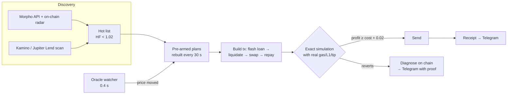

# DeFi Liquidation & Arbitrage Engine — Base + Solana

*Read this in Portuguese: [README.pt-BR.md](README.pt-BR.md) · Back to the [portfolio](../README.md)*

A production-style system that watches lending protocols on **Base** (Morpho Blue, Aave v3, Moonwell) and
**Solana** (Kamino, Jupiter Lend), finds positions that can be liquidated, builds the complete transaction
with a **flash loan**, **simulates it against the live chain with real network costs**, and only then decides
whether to send it. It runs 24/7 on two free Oracle Cloud VMs and reports every result and error to Telegram.

This repository is a **portfolio**: architecture, measured results and an open-source analysis tool.
The execution code (signing/sending) is private.

## What it does

| Area | Details |
|---|---|
| Discovery | Morpho Blue official API + on-chain reads (≈51,000 positions tracked on Base); Kamino scan of 135,000+ obligations; 109 Jupiter Lend vaults read through the protocol's own liquidation simulation |
| Pre-armed engine | Positions close to liquidation (health factor 0.95–1.02 on Base, LTV ≥ 97% of the liquidation threshold on Kamino) have their plan built in advance; a dedicated watcher fires the ready plan when the oracle moves |
| Execution | Flash loan (Morpho, 0 fee) → liquidate → sell collateral (Uniswap V3, Aerodrome Slipstream, KyberSwap, ERC-4626 redemption; Jupiter/Meteora on Solana) → repay, all in **one atomic transaction**; profit settles in USDC |
| Safety | Exact simulation (`eth_simulateV1` / `simulateTransaction`) before every send; on-chain profit guard (network cost + US$ 0.02 floor) inside the executor contract; 24 h revert cap |
| Self-diagnosis | When a simulation reverts, the bot reads the chain at that block and states *why* (e.g. "already liquidated by 0x… in block N, oracle updated by Chainlink SVR in the same block") |
| Observability | Telegram: hourly summary + every error with its proof; command-line tools that print evidence (radar size, engine funnel, simulations approved/rejected with reasons) |

## Architecture



More detail: [docs/ARCHITECTURE.md](docs/ARCHITECTURE.md) · Case study: [docs/CASE_STUDY.md](docs/CASE_STUDY.md)

## Open-source tool: Base liquidation market stats

[`tools/base_liquidation_stats.py`](tools/base_liquidation_stats.py). Standard library only, public RPCs, read-only.
It answers a business question from raw chain data: **who wins liquidations on Base, and what does it cost?**

```
python3 tools/base_liquidation_stats.py 24
```

Real output, 13 hours on 2026-11-07 ([full file](examples/sample_output_13h_2026-11-07.txt)):

```
SVR     : 6 tx  | 99 liquidations | repaid US$ 673,101 | gross bonus ~US$ 85,322 (bid ceiling) | gas 0.19 ETH
LEFTOVER: 52 tx | 94 liquidations | repaid US$  70,591 | gross bonus ~US$  8,948 | gas 1.44 ETH | 30 reverted (burned 0.65 ETH)
PUBLIC  : 7 tx  |  7 liquidations | repaid US$      31
```

Finding: on Base, almost all liquidation value now flows through **Chainlink SVR auctions** (the oracle update
and the liquidations land in the auction winner's own transaction). Bots fighting for the leftovers in the same
block burned 0.65 ETH of gas on reverted attempts in half a day.

## Honest status

- The engine works end to end in simulation on real positions (e.g. 12 of 14 large WETH-debt positions and 8 of 8
  cbXRP positions pass the full flash-loan transaction at the liquidation price).
- **No realized profit yet.** The measured reason is market structure (SVR auctions and same-block competition),
  documented by the tool above, not a defect of the engine.

## Stack

Python 3 (web3.py, eth-abi), Node.js 22 (@solana/web3.js, Kamino klend-sdk, Jupiter Lend SDK, Meteora DLMM),
Solidity (flash-loan executor), systemd services on Ubuntu (Oracle Cloud free tier), Telegram Bot API.

## Contact

Lucas Raisi: [GitHub](https://github.com/lucasraisi) · add your LinkedIn / e-mail here
